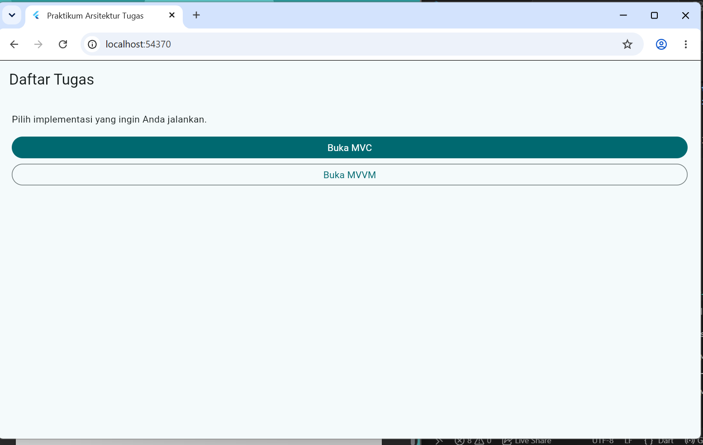
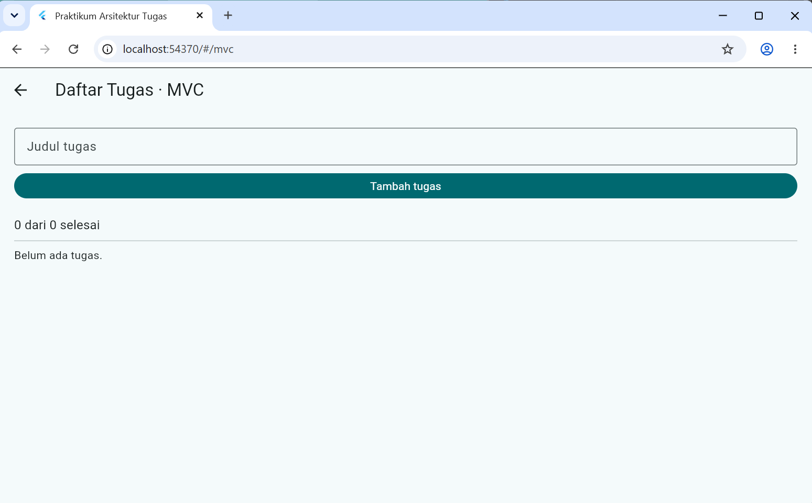
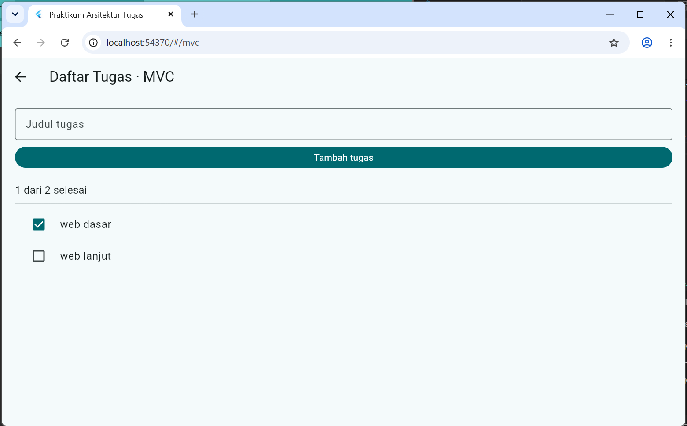
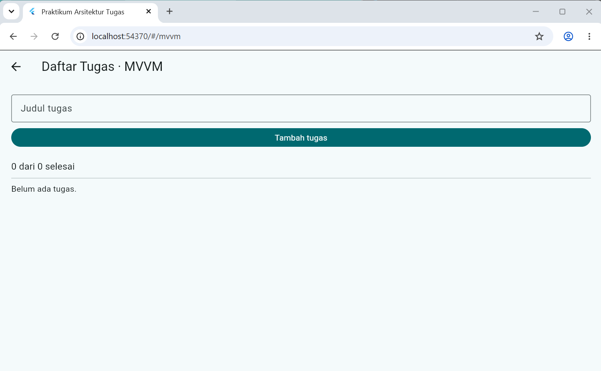
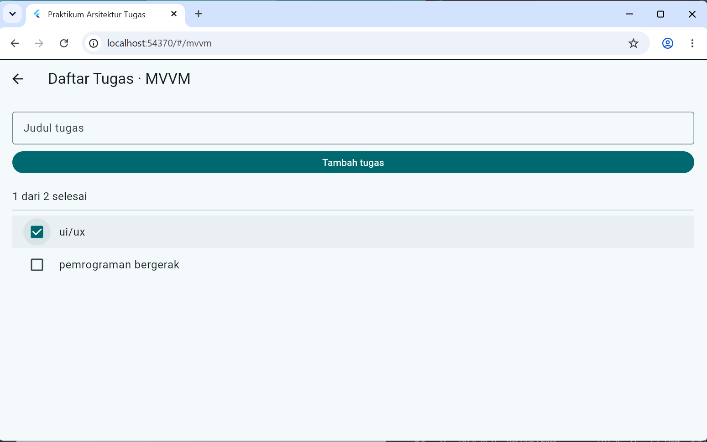
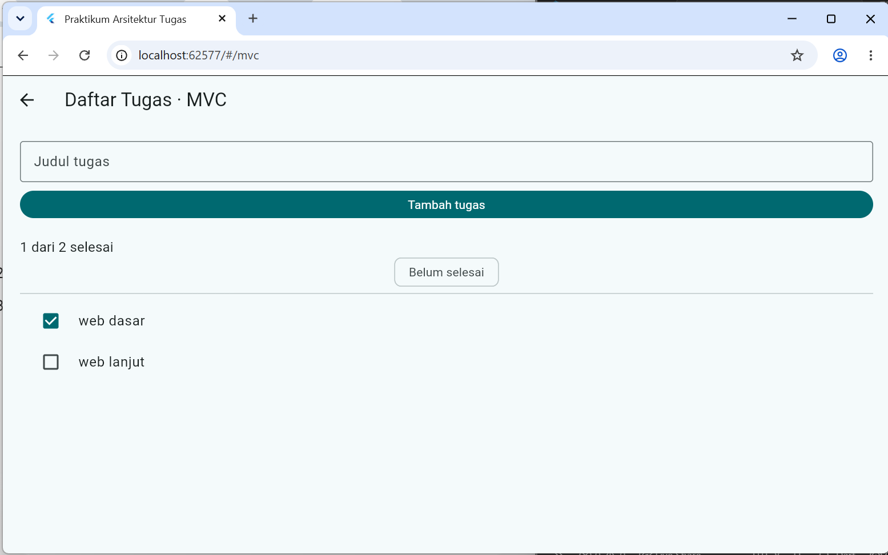
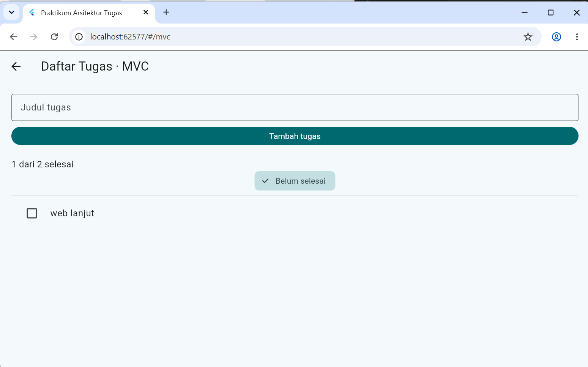
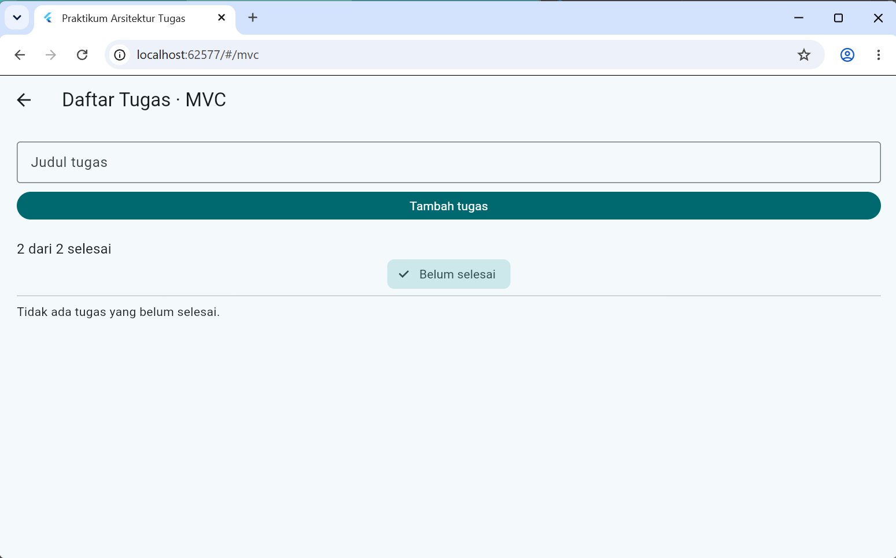

# Praktikum Mandiri: MVC, MVVM, dan Pengujian Flutter

## Identitas
* **Nama:** [Ira Agustin]
* **NIM:** [362558302014]
* **Kelas:** [TRPL 2E]

## Cara Menjalankan & Test
flutter pub get
flutter run -d chrome
flutter analyze
flutter test

## Perbandingan MVC dan MVVM

| Pertanyaan | MVC | MVVM |
| :--- | :--- | :--- |
| **1. Penerima aksi & penyimpan pilihan filter** | Diterima `LayarMvcState.ubahFilter()`, diteruskan ke `PengendaliTugas.ubahFilter()`, dan disimpan di variabel `_filter`. | Diterima langsung oleh `TugasViewModel.ubahFilter()` dan disimpan di variabel `_filter`. |
| **2. Pemicu rebuild & akibat jika dihapus** | **Pemicu:** `setState()` di `LayarMvcState`. **Akibat:** Data di belakang layar berubah, tapi tampilan (chip dan daftar) diam saja tidak ter-update. | **Pemicu:** `notifyListeners()` di `TugasViewModel` yang didengar `ListenableBuilder`. **Akibat:** Data berubah di memori, tapi UI tidak diperbarui dan widget test gagal. |
| **3. Kapan memilih pola ini** | **Cocok:** Layar sederhana dengan sedikit aksi. **Kelebihan:** Alur kode mudah dilacak di satu file layar. **Risiko:** Rawan lupa memanggil `setState()` saat aksi bertambah. | **Cocok:** Layar kompleks (seperti ada filter & ringkasan terpisah). **Kelebihan:** State terpusat di ViewModel dan gampang di-unit test tanpa UI. **Risiko:** Setup awal lebih banyak dan harus memanggil `dispose()`. |

## Hasil Pengujian & Percobaan
* Hasil 'flutter analyze`:
    Analyzing prak_arsitektur_tugas...                                      
    No issues found! (ran in 27.3s)
* Hasil `flutter test`:
    00:04 +5: All tests passed!  

## Bukti Tangkapan Layar (Running App)
| Halaman Beranda (HomePage) | Halaman Detail mvp (DetailPage) | Halaman Detail mvvp (DetailPage) |
|---|---|---|
|  |    |   |

## Bukti Tangkapan Layar Setelah diterapkan filter
| detail mvp (DetailPage) | Halaman filter belum selesai (DetailPage) | Halaman filter belum selesai (DetailPage) |
|---|---|---|
|  |  |  |